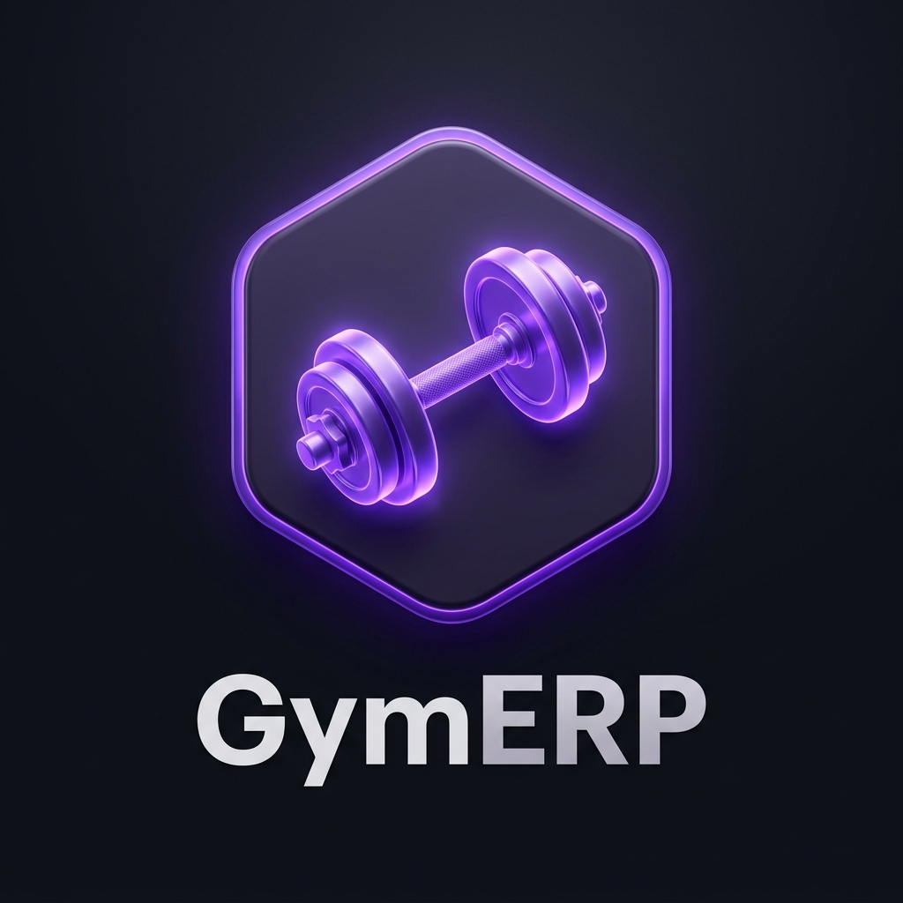
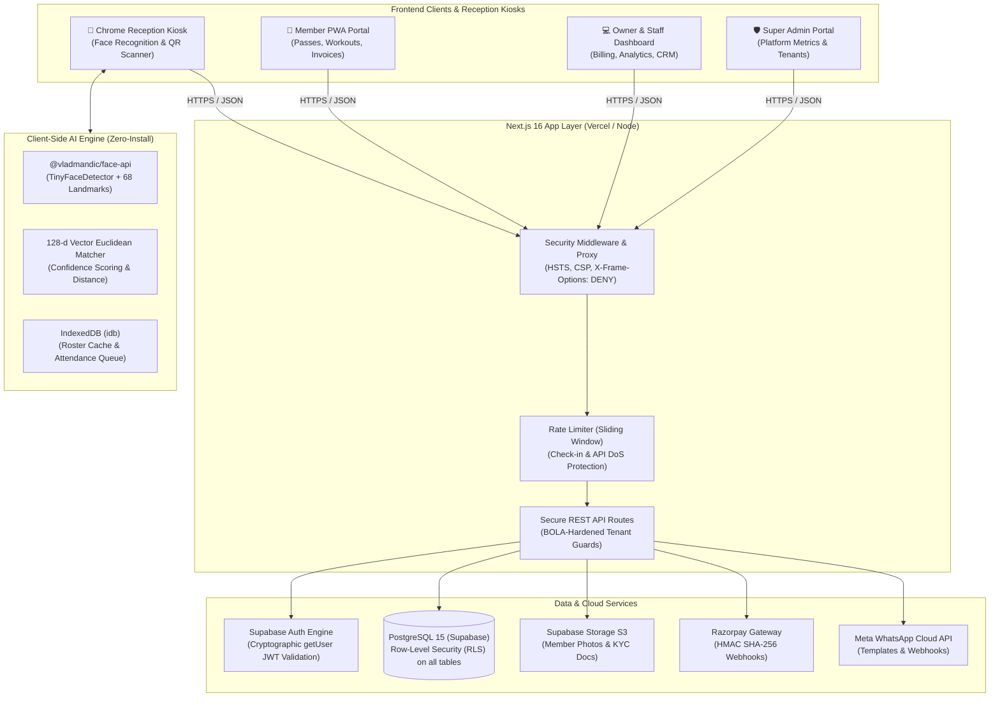
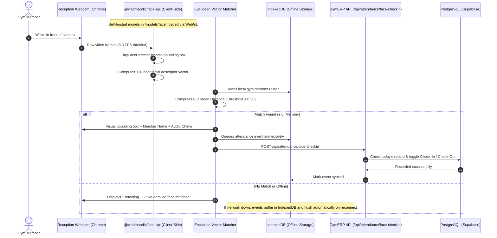
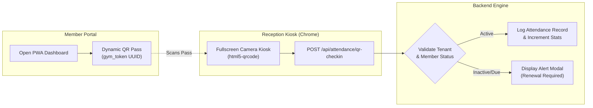

<div align="center">

  

  # 🏋️‍♂️ GymERP

  ### **Enterprise Multi-Tenant SaaS & Zero-Install Biometric Management Platform**

  [-black?style=for-the-badge&logo=next.js&logoColor=white)](https://nextjs.org/)
  [](https://react.dev/)
  [](https://www.typescriptlang.org/)
  [](https://supabase.com/)
  [](https://github.com/vladmandic/face-api)
  [](https://tailwindcss.com/)
  [](https://vitest.dev/)
  [](#-security--compliance)

  <br />

  **GymERP** is an all-in-one, multi-tenant cloud SaaS engineered for fitness centers, martial arts dojos, and athletic franchises. It pairs member lifecycle management, GST billing, and WhatsApp CRM with a **zero-install, in-browser AI face recognition attendance kiosk** and **browser-native QR scanner** that run directly inside Google Chrome without desktop software installation.

  <br />

  [✨ Features](#-key-features) • [🏛️ System Architecture](#-system-architecture) • [👁️ Face Recognition Engine](#-in-browser-ai-face-recognition-zero-install) • [📱 QR Kiosk](#-browser-native-qr-code-kiosk) • [📂 Project Structure](#-project-structure) • [🚀 Quick Start](#-getting-started) • [🔒 Security](#-security--compliance)

  <hr />

</div>

---

## 🌟 Key Features

```
┌────────────────────────────────────────────────────────────────────────────────────────┐
│                                   GYMERP PLATFORM MATRIX                               │
├───────────────────────┬────────────────────────┬───────────────────────────────────────┤
│ 🏢 Core SaaS Engine   │ 💳 Billing & WhatsApp  │ 👁️ Attendance & AI Kiosk              │
├───────────────────────┼────────────────────────┼───────────────────────────────────────┤
│ • Multi-Tenant RBAC   │ • GST Tax Invoicing    │ • In-Browser Face Recognition (Chrome)│
│ • Super Admin Portal  │ • Razorpay Webhooks    │ • Dynamic QR Pass & Scanner Kiosk     │
│ • Branch Management   │ • WhatsApp Cloud API   │ • Zero-Install WebGL Acceleration     │
│ • Lead & Member CRM   │ • Auto Expiry Alerts   │ • Offline-First IndexedDB Sync Queue  │
│ • Member PWA Portal   │ • PDF Generation       │ • DPDP 2023 Biometric Privacy & Erasure│
└───────────────────────┴────────────────────────┴───────────────────────────────────────┘
```

### 👁️ Zero-Install In-Browser Face Recognition Attendance
* **100% Client-Side Detection**: Powered by `@vladmandic/face-api` using WebGL hardware acceleration directly in Chrome.
* **Privacy by Design**: Never transmits or stores photos. Extracts only irreversible 128-dimensional mathematical descriptor vectors.
* **DPDP Act 2023 Compliant**: Explicit biometric consent capture and one-click Right to Erasure biometric deletion.
* **Offline-First Resilience**: Local IndexedDB caching with automatic background queue synchronization upon reconnection.
* **Smart Duplication Prevention**: Configurable 5-minute deduplication window and intelligent automatic Check-In / Check-Out toggling.

### 📱 Browser-Native Dynamic QR Kiosk
* **Personal Digital Pass**: Members access their unique dynamic QR code directly from their mobile portal.
* **Dedicated Kiosk Mode**: Fullscreen reception kiosk running in the browser utilizing device cameras via `html5-qrcode`.
* **Tamper-Proof Verification**: UUID-backed QR tokens validated against active membership status with zero hardware controllers needed.

### 🏢 Multi-Tenant SaaS & Super Admin
* **Tier Gating**: Built-in `Free`, `Pro`, and `Enterprise` subscription tiers with feature flags, member caps, and branch isolation.
* **Super Admin Dashboard**: Platform MRR/ARR analytics, gym onboarding, subscription lifecycle management, and administrative impersonation.
* **Role-Based Access Control**: Strict access boundaries separating `owner`, `receptionist`, `trainer`, and `member`.

### 💳 Automated Invoicing, GST & Payment Gateway
* **GST Invoicing**: Automatic GST-compliant tax calculations (CGST/SGST), discount safeguards, and sequential numbering.
* **Razorpay Integration**: Server-resolved order pricing and cryptographic HMAC SHA-256 webhook processing.
* **Server-Side PDF Generation**: Downloadable tax invoices, personalized workout routines, and diet charts.

### 💬 WhatsApp Cloud CRM Automation
* **Automated Member Alerts**: Due date reminders, membership expiry notifications, welcome messages, and receipts.
* **Template Broadcast Engine**: High-throughput, rate-limited template broadcasting for gym announcements.
* **Interactive Bot**: Webhook auto-responder providing instant membership status and renewal details.

---

## 🏛️ System Architecture



---

## 👁️ In-Browser AI Face Recognition (Zero-Install)

The face recognition system operates **100% inside the client's web browser** using hardware-accelerated WebGL and WebAssembly. No Python scripts, native drivers, or desktop binaries are required.



### Privacy & Biometric Architecture:
* **Mathematical Descriptors Only**: Stored as a 128-element float array in `members.face_descriptor`. It is mathematically impossible to reconstruct a human face from this vector.
* **DPDP 2023 Ready**: Captures explicit user consent (`consent_given_at`) before activation.
* **Right to Erasure**: Dedicated `DELETE /api/members/:id/face-enroll` endpoint completely scrubs biometric descriptors.

---

## 📱 Browser-Native QR Code Kiosk

For gyms without webcams or for contact-free entry, GymERP provides a real-time QR attendance pipeline:



---

## 📂 Project Structure

```
.
├── public/
│   ├── gymerp_app_logo.jpg         # Application logo branding
│   └── models/face/                # Self-hosted TensorFlow.js face models
│       ├── tiny_face_detector_model*
│       ├── face_landmark_68_model*
│       └── face_recognition_model*
│
├── src/
│   ├── app/                        # Next.js 16 App Router
│   │   ├── api/                    # Secure REST API Endpoints
│   │   │   ├── attendance/         # Face roster, face check-in, QR check-in
│   │   │   ├── cron/               # Timing-safe automated background tasks
│   │   │   ├── members/            # Member management & biometric enrollment
│   │   │   ├── payments/           # Razorpay order generation & webhooks
│   │   │   ├── superadmin/         # Platform billing, MRR & impersonation
│   │   │   └── whatsapp/           # Meta Cloud API broadcast & webhook
│   │   ├── dashboard/              # Owner & Staff Admin Management Portal
│   │   │   └── attendance/         # Attendance log, Face Kiosk & QR Kiosk
│   │   ├── member/                 # Mobile-first Member Self-Service Portal
│   │   └── superadmin/             # Multi-tenant Master SaaS Dashboard
│   │
│   ├── components/                 # React 19 UI Components
│   │   ├── attendance/             # FaceEnrollmentModal & Kiosk controls
│   │   ├── layout/                 # Navigation, Sidebars & Header bars
│   │   └── ui/                     # Radix UI + Tailwind CSS primitives
│   │
│   ├── lib/
│   │   ├── face-attendance/        # In-browser face recognition engine
│   │   │   ├── matcher.ts          # Euclidean vector distance & confidence math
│   │   │   ├── models.ts           # Model weight loader & memory manager
│   │   │   ├── offline-db.ts       # IndexedDB roster & queue storage
│   │   │   ├── sync.ts             # Online/offline queue flush mechanism
│   │   │   └── types.ts            # Integration contract definitions
│   │   ├── server/
│   │   │   └── rate-limit.ts       # Sliding-window in-memory rate limiter
│   │   ├── supabase/               # Server, client & admin Supabase connectors
│   │   └── whatsapp/               # Meta Cloud API client & message templates
│   │
│   ├── test/                       # Vitest Automated Test Suite
│   │   └── unit/                   # Vector math, formatters, QR, permissions
│   └── types/                      # TypeScript schemas & DB definitions
│
├── supabase/
│   └── migrations/                 # Sequential PostgreSQL RLS Schemas
│       ├── 001_initial.sql
│       ├── 002_v2_features.sql
│       ├── 003_push_subscriptions.sql
│       ├── 004_platform_subscriptions.sql
│       ├── 005_qr_attendance.sql
│       └── 006_in_browser_face_attendance.sql
│
├── next.config.ts                  # Hardened CSP, Permissions-Policy & Headers
└── package.json                    # Dependencies & automation scripts
```

---

## 🔒 Security & Compliance

GymERP implements a comprehensive, defense-in-depth security model:

```
┌────────────────────────────────────────────────────────────────────────────────────────┐
│                                 DEFENSE-IN-DEPTH MATRIX                                │
├───────────────────────────┬────────────────────────────────────────────────────────────┤
│ 🛡️ BOLA Prevention        │ Server-side tenant isolation via users table; prevents    │
│                           │ cross-gym member, descriptor, or check-in spoofing.        │
├───────────────────────────┼────────────────────────────────────────────────────────────┤
│ ⏱️ Timing Attack Defense  │ Constant-time crypto.timingSafeEqual for Razorpay webhooks,│
│                           │ CCTV auth tokens, Meta signatures, and Cron secrets.       │
├───────────────────────────┼────────────────────────────────────────────────────────────┤
│ 🚦 API Rate Limiting      │ In-memory sliding window limiter protecting sensitive      │
│                           │ attendance, enrollment, and messaging endpoints from DoS.  │
├───────────────────────────┼────────────────────────────────────────────────────────────┤
│ 🗄️ Database Row Security   │ PostgreSQL RLS enabled across all tables; tenant isolation │
│                           │ enforced by Postgres user contexts.                        │
├───────────────────────────┼────────────────────────────────────────────────────────────┤
│ 🌐 Header Hardening       │ Strict CSP with wasm-unsafe-eval, worker-src 'self' blob:, │
│                           │ Permissions-Policy: camera=(self), and X-Frame-Options: DENY.│
└───────────────────────────┴────────────────────────────────────────────────────────────┘
```

---

## 🚀 Getting Started

### Prerequisites

* **Node.js**: `v20.x` or higher
* **npm** / **pnpm** / **bun**
* **Supabase Project**: Free or Pro Supabase PostgreSQL instance

---

### 1. Clone & Install Dependencies

```bash
git clone https://github.com/prashantb2400/GYM-ERP-2.git
cd GYM-ERP-2

# Install dependencies
npm install
```

---

### 2. Configure Environment Variables

Create a `.env.local` file in the root directory:

```bash
cp .env.example .env.local
```

Key environment configurations:

| Variable | Description | Source / Usage |
| :--- | :--- | :--- |
| `NEXT_PUBLIC_SUPABASE_URL` | Supabase Project API URL | Supabase Dashboard > API |
| `NEXT_PUBLIC_SUPABASE_ANON_KEY` | Public Supabase Key | Supabase Dashboard > API |
| `SUPABASE_SERVICE_ROLE_KEY` | Supabase Admin Secret Key | Supabase Dashboard > API |
| `RAZORPAY_KEY_ID` | Razorpay Merchant Key | Razorpay Dashboard |
| `RAZORPAY_KEY_SECRET` | Razorpay Secret | Razorpay Dashboard |
| `WHATSAPP_TOKEN` | Meta Graph API System Token | Meta Developers Console |
| `WHATSAPP_PHONE_NUMBER_ID` | WhatsApp Business Phone ID | Meta Developers Console |
| `WHATSAPP_APP_SECRET` | Meta App Secret for Webhooks | Meta Developers Console |
| `CRON_SECRET` | Secret for Cron Authorization | `openssl rand -hex 32` |
| `ENABLE_DEMO_SEED` | Safe flag for demo seeding | Set to `true` only for dev |

---

### 3. Apply Database Migrations

Apply sequential PostgreSQL migrations in order:

```bash
# Using Supabase CLI
supabase db push

# Or run migrations 001 through 006 sequentially in Supabase SQL Editor:
# 001_initial.sql
# 002_v2_features.sql
# 003_push_subscriptions.sql
# 004_platform_subscriptions.sql
# 005_qr_attendance.sql
# 006_in_browser_face_attendance.sql
```

---

### 4. Run Development Server

```bash
npm run dev
```

Visit `http://localhost:3000` to launch GymERP.

---

## 🧪 Testing & Automated Verification

GymERP comes with unit and integration tests powered by **Vitest**:

```bash
# Run unit tests
npm test

# Run TypeScript typecheck
npx tsc --noEmit

# Run ESLint validation
npm run lint

# Build production bundle
npm run build
```

---

## 📄 License

This project is licensed under the [MIT License](LICENSE).

<div align="center">
  <sub>Engineered with precision for gym owners, coaches, and fitness communities worldwide.</sub>
</div>
