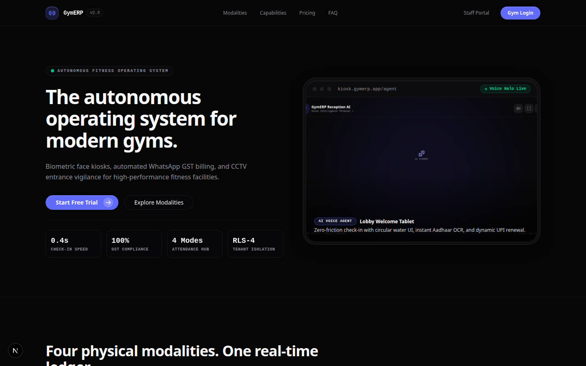
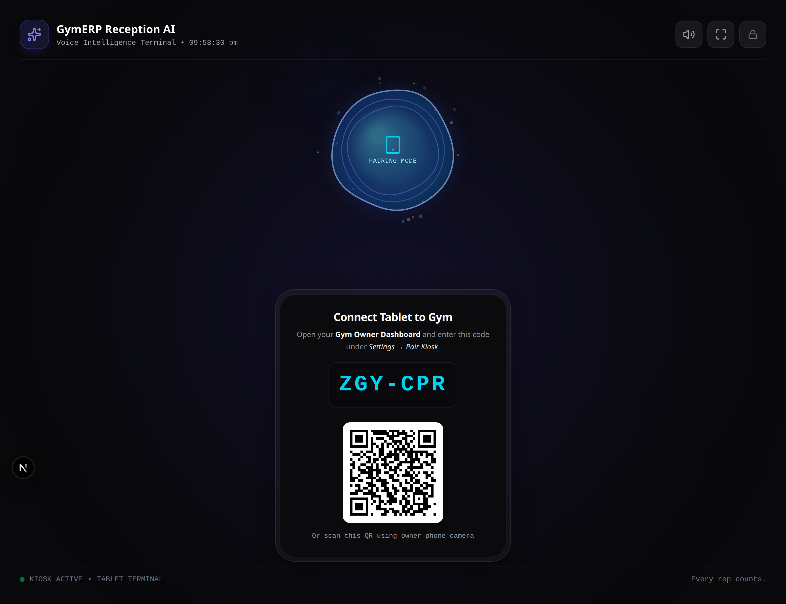
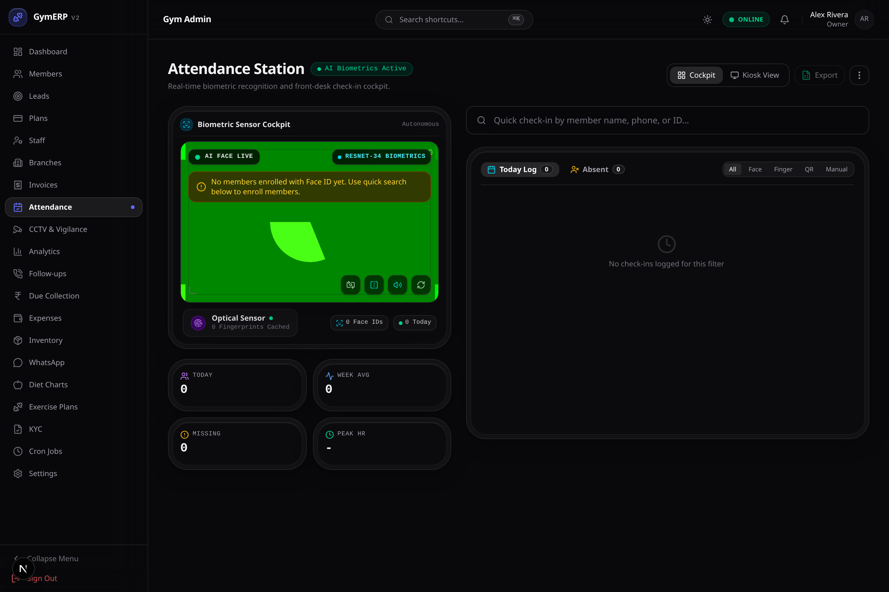
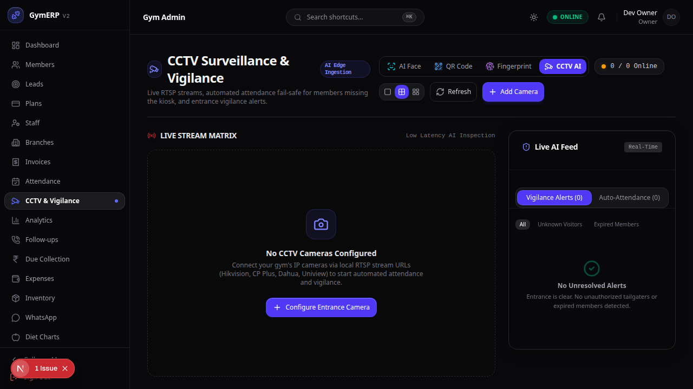
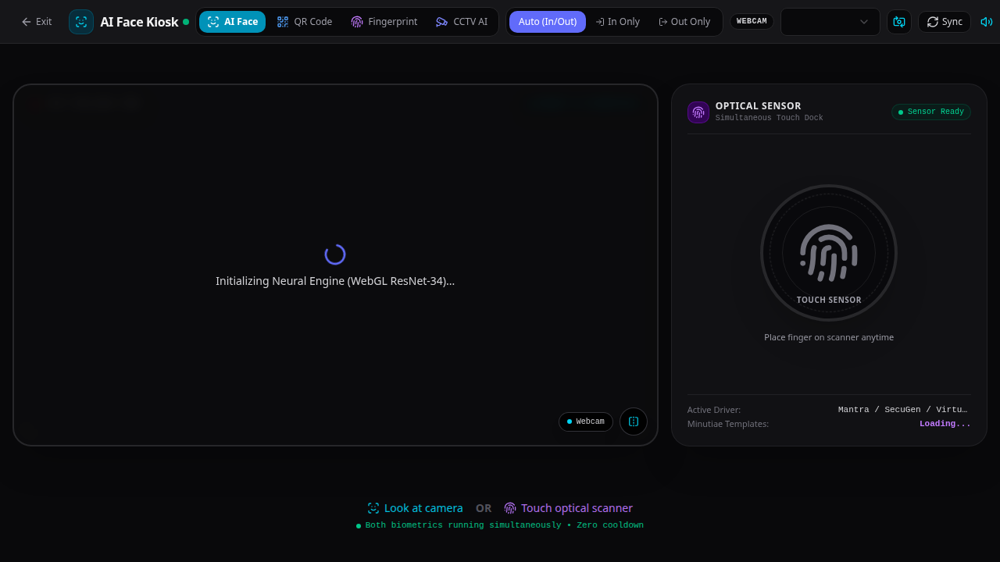
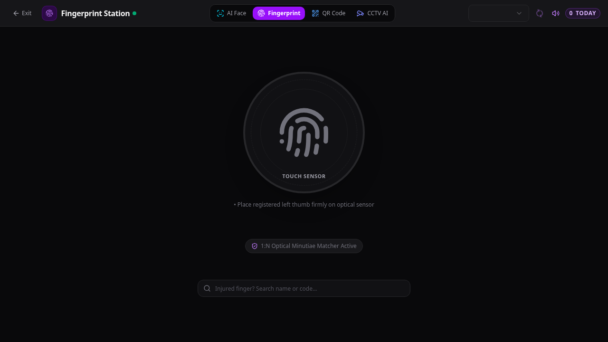
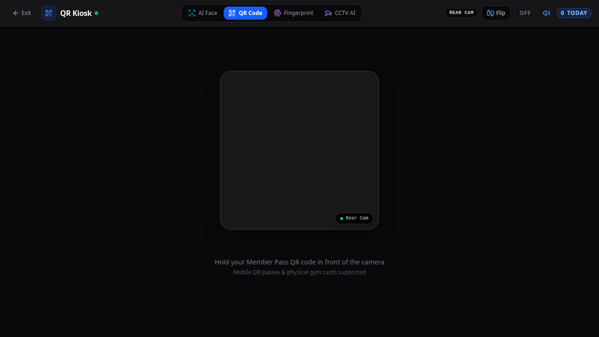
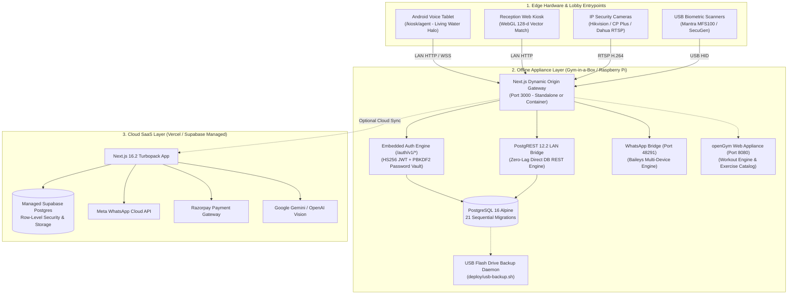

<div align="center">

  

  # 🏋️‍♂️ GymERP v2.6

  ### **Autonomous Multi-Tenant Gym SaaS • AI Voice Kiosk • CCTV Vigilance Matrix • Zero-Internet Edge Appliance**

  <p align="center">
    <a href="https://nextjs.org/"></a>
    <a href="https://react.dev/"></a>
    <a href="https://www.typescriptlang.org/"></a>
    <a href="https://supabase.com/"></a>
    <a href="https://www.docker.com/"></a>
    <a href="https://modelcontextprotocol.io/"></a>
    <a href="https://vitest.dev/"></a>
  </p>

  <p align="center">
    <a href="#-visual-interface-tour">🖼️ Visual Tour</a> •
    <a href="#-1-click-frictionless-setup">⚡ 1-Click Launchers</a> •
    <a href="#-platform-matrix">⚡ Platform Matrix</a> •
    <a href="#-system-architecture">🏛️ Architecture</a> •
    <a href="#-exercise-science--personal-trainer-hub-opengym-integration">🏋️ Workout Hub</a> •
    <a href="#-attendance-ecosystem">🎯 4 Attendance Modalities</a> •
    <a href="#-zero-internet-appliance-gym-in-a-box">📦 Offline Appliance</a> •
    <a href="#-deployment-guide">🚀 Deployment Guide</a> •
    <a href="#-android-kiosk-apk">📱 Android APK</a> •
    <a href="#-whatsapp-engine">💬 WhatsApp Engine</a> •
    <a href="#-mcp-server">🤖 MCP Server</a>
  </p>

  <br />

  <a href="#-visual-interface-tour">
    
  </a>

  <p align="center">
    <em>Modern dark-mode cockpit featuring real-time analytics, automated billing, and live biometric telemetry.</em>
  </p>

</div>

---

## ⚡ 1-Click Frictionless Setup

GymERP is engineered so gym owners with zero technical experience can launch and run their gym in seconds:

```
┌────────────────────────────────────────────────────────────────────────┐
│                        FRICTIONLESS GYM SETUP                          │
│                                                                        │
│   [ 🪟 Windows Desktop ]             [ 🐧 Linux / 🍓 Raspberry Pi ]    │
│   Double-click: start-gymerp.bat     Run: ./start-gymerp.sh            │
│            │                                    │                      │
│            ▼                                    ▼                      │
│   • Auto-detects Docker / Node.js      • Resolves local Wi-Fi IP       │
│   • Auto-provisions local config       • Auto-opens default browser    │
│            │                                    │                      │
│            └─────────────────┬──────────────────┘                      │
│                              ▼                                         │
│            [ 🌐 Browser: http://localhost:3000/setup ]                 │
│            • Step 1: Gym Profile (Name, Phone, UPI QR)                 │
│            • Step 2: Owner Login Credentials                           │
│            • Step 3: Starter Membership Plans                          │
│            • Step 4: Kiosk QR Instant Auto-Pairing                     │
│                              │                                         │
│                              ▼                                         │
│            Scan QR on screen with tablet -> Kiosk is Live!             │
└────────────────────────────────────────────────────────────────────────┘
```

### Installation Options for Owners

| Platform | Recommended Method | How It Works |
| :--- | :--- | :--- |
| **Windows 10 / 11** | **`start-gymerp.bat`** (or `GymERP-Setup.exe`) | Double-click batch file. Auto-starts Docker or Node, opens firewall ports 3000, 54321, 48291, and launches browser to `/setup`. |
| **Linux / Raspberry Pi** | **`./start-gymerp.sh`** | 1-line shell launcher. Resolves LAN IP (`http://192.168.x.x:3000`) and launches browser automatically. |
| **Docker Compose** | **`docker compose -f docker-compose.offline.yml up -d`** | 1-command startup for offline mini-PCs and servers. Includes DB, PostgREST, and WhatsApp bridge. |
| **Windows Installer** | **`deploy/windows-installer.iss`** | Compiles single-file `GymERP-Setup.exe` with desktop shortcut, start menu entry, and auto-start service via Inno Setup. |
| **USB Auto-Backup** | **`deploy/usb-backup.sh`** | Plug any USB flash drive into the PC to automatically export a timestamped `.sql.gz` snapshot. |

---

## 📸 Visual Interface Tour

Experience GymERP's purpose-built interfaces designed for front-desk staff, gym owners, members, and autonomous lobby hardware.

### 1. Autonomous AI Voice Kiosk & Live Attendance Cockpit

<table>
  <tr>
    <td width="50%" align="center">
      
      <br />
      <strong>🤖 Autonomous AI Voice Tablet Kiosk (<code>/kiosk/agent</code>)</strong>
      <p align="left"><em>Living circular water halo orb responding in real time to speech, vision watchdog auto-checkin, voice onboarding, KYC camera OCR, and direct thermal ESC/POS receipt printing.</em></p>
    </td>
    <td width="50%" align="center">
      
      <br />
      <strong>📊 Real-Time Attendance Cockpit (<code>/dashboard/attendance</code>)</strong>
      <p align="left"><em>Live member counter, peak rush hour heatmap, multi-modality check-in feed, quick member lookup, and unified attendance logs with one-click status filters.</em></p>
    </td>
  </tr>
</table>

### 2. Multi-Feed CCTV Surveillance & Attendance Modalities

<table>
  <tr>
    <td width="50%" align="center">
      
      <br />
      <strong>📹 CCTV Surveillance Matrix (<code>/dashboard/cctv</code>)</strong>
      <p align="left"><em>RTSP camera grid (1x1, 2x2, 3x3) with edge face detection fail-safe, un-badged visitor capture, and vigilance alert triage for overdue members.</em></p>
    </td>
    <td width="50%" align="center">
      
      <br />
      <strong>👤 WebGL In-Browser Face Kiosk</strong>
      <p align="left"><em>Zero-install, browser-based 128-d vector face matching running on client GPUs via TensorFlow.js with anti-spoof liveness detection and zero native software.</em></p>
    </td>
  </tr>
  <tr>
    <td width="50%" align="center">
      
      <br />
      <strong>👆 Biometric Fingerprint Station</strong>
      <p align="left"><em>USB HID driver abstraction for Mantra MFS100 and SecuGen Pro 20 optical scanners with ISO minutiae template matching and offline caching.</em></p>
    </td>
    <td width="50%" align="center">
      
      <br />
      <strong>📱 Dynamic Sound-Wave QR Station</strong>
      <p align="left"><em>Rotating cryptographically signed member mobile QR passes with ultrasonic sound-wave verification and instant audio chime feedback.</em></p>
    </td>
  </tr>
</table>

---

## ⚡ Platform Matrix

```
+-----------------------------------------------------------------------------------------------------------------------------+
|                                                 GYMERP SYSTEM CAPABILITIES                                                  |
+--------------------------+--------------------------+---------------------------+-----------------------+-------------------+
| 🏢 Multi-Tenant SaaS     | 🤖 Autonomous AI Kiosk   | 📹 Attendance Ecosystem   | 📦 Offline Appliance  | 🏋️ Exercise Science|
+--------------------------+--------------------------+---------------------------+-----------------------+-------------------+
| - Tenant & Branch RLS    | - Living Water Halo UI   | - Live RTSP Camera Matrix | - Zero-Internet Ready | - Epley/Brzycki 1RM|
| - Platform Super Admin   | - 6-Digit Pairing PIN    | - CCTV Auto-Attendance    | - Embedded Auth Engine| - Olympic Plate Math|
| - GST Tax Invoicing      | - Speech-to-Speech LLM   | - WebGL Face Match (128d) | - PostgREST LAN Proxy | - PPL & 5x5 Routines|
| - Razorpay Integration   | - KYC ID Document OCR    | - Mantra/SecuGen Scanner  | - Vector UPI QR Codes | - Overload Rules  |
| - Dual WhatsApp Engine   | - Thermal ESC/POS Print  | - Dynamic Member QR Pass  | - 4-Step Setup Wizard | - WhatsApp Sharing|
| - Granular Role RBAC     | - Offline Auto-Pairing   | - Instant Station Switch  | - 1-Click USB Backup  | - openGym Sidecar |
+--------------------------+--------------------------+---------------------------+-----------------------+-------------------+
```

---

## 🏛️ System Architecture



---

## 🏋️‍♂️ Exercise Science & Personal Trainer Hub (openGym Integration)

GymERP integrates algorithms and workout paradigms from the open-source **[openGym](https://github.com/DuarteSantos8/openGym)** project, transforming the platform from administrative management into a complete 360-degree fitness operating system:

```
+---------------------------------------------------------------------------------------------------------+
|                                    OPENGYM EXERCISE SCIENCE SUBSYSTEM                                   |
+--------------------------+--------------------------+---------------------------+-----------------------+
| 📐 1RM Power Formulas   | 🏋️ Olympic Barbell Math  | 📈 Progressive Overload   | 📲 WhatsApp Sharing   |
+--------------------------+--------------------------+---------------------------+-----------------------+
| - Epley: W*(1 + R/30)    | - Olympic 20kg Barbell   | - Linear Progression (LP) | - 1-Click Send Routine|
| - Brzycki: W*(36/(37-R)) | - Smith Machine (15kg)   | - Greyskull LP (AMRAP)    | - Formatted Exercises |
| - Lander & Lombardi math | - EZ-Curl Bar (10kg)     | - Double Progression      | - Target Reps & RPE   |
| - RPE / RIR adjustments  | - Greedy Plate Knapsack  | - Automated Deload (-10%) | - Trainer Notes       |
+--------------------------+--------------------------+---------------------------+-----------------------+
```

### Core Subsystems:
1. **Native Exercise Science Engine (`src/lib/workout/`)**:
   - **One-Rep Max Estimator (`one-rep-max.ts`)**: Implements Epley, Brzycki, Lander, and Lombardi formulas with RPE (Rating of Perceived Exertion) and RIR (Reps in Reserve) calibration.
   - **Barbell Plate Calculator (`plate-calculator.ts`)**: Solves exact plate pair configurations for Olympic (20kg), Smith (15kg), and EZ-curl (10kg) bars using a greedy knapsack algorithm across standard metric plates (25, 20, 15, 10, 5, 2.5, 1.25 kg).
   - **Progressive Overload Protocols (`progression.ts`)**: Encodes Linear Progression (adding 2.5kg upper / 5kg lower body), Greyskull LP with AMRAP final sets, Double Progression within target rep windows, and automatic 10% deload triggers after repeated session plateaus.
   - **Exercise Taxonomy & Starter Templates (`exercise-types.ts`)**: Full anatomical muscle group taxonomies, equipment filters, and ready-to-train Push/Pull/Legs (PPL) and StrongLifts 5x5 routines.

2. **Personal Trainer Dashboard (`/dashboard/workouts`)**:
   - **Live Plate Visualizer**: Instant visual breakdown of plates needed per side on the bar.
   - **Interactive 1RM Calculator**: Live estimation of maximum single-rep potential based on working sets.
   - **1-Click WhatsApp Routine Dispatch**: Generates clean, formatted training plans and dispatches them directly to members via the WhatsApp engine.

3. **Member Workout Companion (`/member/exercise`)**:
   - **Interactive Live Logger**: Workout logging on mobile with planned sets, live weight/reps inputs, RPE exertion selectors, and set-by-set completion checkboxes.
   - **Integrated Rest Timer**: Auto-starts countdown rest intervals (60s, 90s, 120s) with synthesized Web Audio chimes.
   - **Floor-Ready Plate Calculator**: Barbell plate loading solver directly in the athlete portal.
   - **Power Max Gauges**: Real-time 1RM updates and strength training percentage zones (95% to 70%).
   - **Workout History**: Expandable timeline of previous gym sessions and historical tonnage lifted.

4. **Workout Logging API (`/api/workouts/log`)**:
   - Logs completed member workout sessions (`workout_logs` table).
   - Computes total training tonnage (volume in kg) and automatically updates estimated personal records (1RMs).

5. **Smart Check-In Auto-Dispatch & WhatsApp Fitness Bot**:
   - **Auto-Dispatch on Attendance**: Automatically formats and sends today's scheduled training split to member's WhatsApp upon check-in across Face, QR, Fingerprint, or Kiosk modalities.
   - **Interactive WhatsApp Commands**: Members can text `WORKOUT`, `PLATES <kg>`, or `PR` to get instant routine details, barbell sleeve configurations, or 1RM stats directly in chat.

6. **Kiosk AI Voice Agent Workout & Plate Math Engine (`/kiosk/agent`)**:
   - **Voice Intent Recognition**: Natural speech parsing detects intents for today's routine ("What is my workout today?"), barbell plate configurations ("Calculate plates for 90 kg"), personal records, and check-in assistance.
   - **Speech Synthesis**: Speaks tailored audio responses with natural en-IN / hi-IN accents via Web Speech API with real-time acoustic envelope syncing to the fluid visual orb.
   - **Lobby Tablet Plate Calculator**: Visual Olympic barbell sleeve visualizer with color-coded disk stack (Red 25kg, Blue 20kg, Yellow 15kg, Green 10kg, White 5kg, Black 2.5kg, Silver 1.25kg) and spoken sleeve instructions.
   - **Check-In Routine Preview**: Displays today's scheduled split on the member verification card with 1-tap "Speak Routine" and "Plate Calc" triggers.

7. **Self-Hosted openGym Appliance Sidecar (`docker-compose.offline.yml`)**:
   - Bundles the openGym container image (`ghcr.io/duartesantos8/opengym-web:latest`) on port `8080` under the `opengym` profile for gyms desiring the full standalone workout tracker UI on their local network.

---

## 🎯 4 Synchronized Attendance Modalities

GymERP ensures zero member check-in bottlenecks during peak hours by running four synchronized attendance channels:

| Modality | Target Device | Hardware Needed | Core Mechanism | Speed |
| :--- | :--- | :--- | :--- | :---: |
| **1. Autonomous Voice Kiosk** | Android Lobby Tablet | Tablet with front camera | Client WebGL Face Watchdog + Voice greeting + Thermal slip | `< 1.2s` |
| **2. CCTV Matrix Surveillance** | Security Cameras | RTSP IP Camera | Background RTSP stream face capture + Triage auto-logging | `< 0.8s` |
| **3. In-Browser Face Kiosk** | Reception Laptop / PC | Standard USB Webcam | 128-d vector matching in Chrome with anti-spoof liveness | `< 0.5s` |
| **4. Fingerprint & Dynamic QR** | Front-Desk Counter | Mantra / SecuGen USB reader | Biometric ISO minutiae template matching or rotating QR pass | `< 0.4s` |

---

## 📦 Zero-Internet Appliance ("Gym-in-a-Box")

GymERP can run completely disconnected from the public internet on a local mini-PC or Raspberry Pi 4/5 installed inside the gym facility.

```
┌────────────────────────────────────────────────────────────────────────┐
│                   GYM-IN-A-BOX LOCAL APPLIANCE TOPOLOGY                │
│                                                                        │
│   [ 📱 Lobby Tablet ]       [ 💻 Reception PC ]    [ 📹 RTSP Cameras ] │
│            │                         │                       │         │
│            ▼                         ▼                       ▼         │
│   ========= Local Gym Wi-Fi / LAN Switch (No Internet Required) ======  │
│                                      │                                 │
│                                      ▼                                 │
│             +------------------------------------------------+         │
│             |  Raspberry Pi 4/5 or Intel Mini-PC Appliance   |         │
│             |                                                |         │
│             |  - Next.js Web App & PostgREST Proxy (:3000)   |         │
│             |  - Embedded Local Auth Engine (/auth/v1/*)     |         │
│             |  - PostgREST Direct API Engine (:54321)        |         │
│             |  - Standalone WhatsApp Baileys Bridge (:48291) |         │
│             |  - Local PostgreSQL 16 Database (:5432)        |         │
│             |  - Automated USB Backup Daemon (deploy/)       |         │
│             +------------------------------------------------+         │
└────────────────────────────────────────────────────────────────────────┘
```

### Key Appliance Capabilities
1. **Embedded Local Auth Engine**: Serves standard `/auth/v1/token`, `/auth/v1/user`, and `/auth/v1/logout` endpoints directly inside Next.js, eliminating external authentication servers and saving over 300MB of RAM.
2. **First-Run Setup Wizard (`/setup`)**: Boots cleanly into a guided setup wizard on uninitialized hardware, configuring gym details, owner credentials, and starter plans in 60 seconds.
3. **Kiosk QR Instant Auto-Pairing**: Generates a dynamic QR code on the setup completion screen. Pointing a tablet camera at the screen connects and launches the kiosk in 2 seconds.
4. **Pure Vector Offline Invoicing**: Generates 100% offline NPCI dynamic UPI QR codes using native vector SVG rendering with zero external network requests.
5. **PostgREST LAN Gateway**: Automatically maps `/rest/v1/*` to PostgREST and dynamically binds client connections to local LAN hostnames (`192.168.x.x`).
6. **1-Click Database Backup**: Download a complete JSON snapshot of all gym data directly from Dashboard Settings, or plug in a USB flash drive for automated daily backups.
7. **Zero-Downtime Migration Synchronization**: Automatically applies idempotent migrations (`001` through `021`) via dedicated `db-migrate` orchestration service with mock storage compatibility before API startup, guaranteeing zero race conditions on cold boots.
8. **Caddy LAN Reverse Proxy & Automatic Local TLS**: Bundles automated Caddy reverse proxy (`caddy:2-alpine`) with internal CA certificate generation (`tls internal`), exposing port 80 (HTTP) and port 443 (HTTPS) for `gymerp.local` and local LAN IPs. Enables mobile and tablet browsers to access `getUserMedia` camera and Web Speech recognition APIs without security restriction dialogs.
9. **Zero-Touch Cold-Boot Auto-Seed**: Set `AUTO_SEED_DEMO_GYM=true` to automatically provision a full demo gym ("Iron Forge Fitness Club"), primary branch, owner credentials (`admin@gymerp.local` / `admin123`), starter plans, openGym workout splits, and pre-paired kiosk token on initial container startup.

### Launching the Local Appliance in 1 Command

```bash
# 1. Clone repository
git clone https://github.com/prashantb2400/GYM-ERP-2.git
cd GYM-ERP-2

# 2. Start the offline appliance stack
docker compose -f docker-compose.offline.yml up -d

# 3. Open browser on any device in the gym network
# Navigate to: http://<appliance-ip>:3000/setup
```

---

## 🚀 Deployment Guide

Choose the deployment architecture that fits your gym operations:

### Option A: Vercel Cloud (SaaS Multi-Tenant Mode)

1. **Clone and Install**:
   ```bash
   git clone https://github.com/prashantb2400/GYM-ERP-2.git
   cd GYM-ERP-2
   npm install
   ```
2. **Setup Supabase Database**:
   - Create a project on [Supabase](https://supabase.com).
   - Execute migrations `001_initial.sql` through `017_cctv_and_vigilance.sql` in `supabase/migrations/`.
3. **Deploy to Vercel**:
   - Link repository to [Vercel](https://vercel.com).
   - Configure environment variables (see [Environment Variables Reference](#-environment-variables-reference)).
   - Deploy production build.

---

### Option B: Linux VPS / Local Mini-PC with PM2 & Nginx

```bash
# 1. System Setup (Ubuntu 22.04 LTS / 24.04 LTS)
sudo apt update && sudo apt install -y nodejs npm nginx git

# 2. Build Next.js Application
git clone https://github.com/prashantb2400/GYM-ERP-2.git /var/www/gymerp
cd /var/www/gymerp
npm install
npm run build

# 3. Start with PM2
sudo npm install -g pm2
pm2 start npm --name "gymerp" -- start -- -p 3000
pm2 save && pm2 startup
```

---

### Option C: Cloudflare Tunnel (Zero Port-Forwarding / CGNAT Bypassing)

When running behind a commercial broadband connection without a public static IP:

```bash
# 1. Install cloudflared
curl -L --output cloudflared.deb https://github.com/cloudflare/cloudflared/releases/latest/download/cloudflared-linux-amd64.deb
sudo dpkg -i cloudflared.deb

# 2. Authenticate and create tunnel
cloudflared tunnel login
cloudflared tunnel create gymerp-tunnel

# 3. Start tunnel
cloudflared tunnel run --url http://localhost:3000 gymerp-tunnel
```

---

## 📱 Android Kiosk APK

GymERP includes an Android Capacitor wrapper project located in `android-kiosk/` for lobby tablets:

- **Immersive Fullscreen**: Hides the status and navigation bars to prevent unauthorized app switching.
- **Hardware Wake-Lock**: Keeps the tablet display active permanently during operating hours.
- **Auto-Granted Permissions**: Grants camera and microphone access automatically on boot for instant face detection and voice interaction.
- **Automated CI Releases**: Bundled with a GitHub Actions workflow (`.github/workflows/android-release.yml`) for automatic APK compilation on git tags.

```bash
# Build Android APK locally
cd android-kiosk
npm install
npx cap sync android
cd android && ./gradlew assembleDebug
```

---

## 💬 WhatsApp Messaging Engine

GymERP supports dual messaging modes to fit any gym's budget and infrastructure:

### Mode 1: Meta WhatsApp Cloud API (Enterprise Official)
- Uses official Meta Graph API v20.0+.
- Best for enterprise gyms with pre-approved WhatsApp message templates.
- Configured via `WHATSAPP_TOKEN` and `WHATSAPP_PHONE_NUMBER_ID`.

### Mode 2: Self-Hosted WhatsApp Bridge 2.0 (`whatsapp-bridge/`)
- Powered by `@whiskeysockets/baileys` multi-device engine.
- **Dual Linking**: Pair via standard camera QR code scanning OR 8-digit **Phone Pairing Code** (`POST /qr/pair`) directly on screen.
- **Anti-Ban Typing Simulation**: Emulates human behavior by transmitting randomized `composing` (typing) presence indicators prior to message dispatch.
- **Push-To-Talk (PTT) Voice Notes**: Transmits audio tips and workout guidance with native green microphone waveforms instead of file attachments.
- **Check-In Workout Auto-Dispatch**: Automatically transmits the member's scheduled split, target exercises, sets, and rest intervals directly to their WhatsApp upon front-desk check-in (Face, QR, Fingerprint).
- **Interactive Fitness Bot Commands**: Members can text `WORKOUT` to receive today's exercises, `PLATES <weight>` for barbell loading math, or `PR` for estimated 1RMs.
- Zero per-conversation Meta messaging fees.
- Includes SQLite auth persistence, rate-limiting queues, and SSE status streaming on port `48291`.

```bash
# Start standalone WhatsApp bridge
cd whatsapp-bridge
npm install
npm run dev
```

---

## 🤖 Model Context Protocol (MCP) Server

GymERP includes a native **MCP Server** (`mcp-server/`) allowing autonomous AI agents (Claude Desktop, Cursor, DeepMind Antigravity) to query and manage gym operations through structured tools:

```json
{
  "mcpServers": {
    "gymerp": {
      "command": "node",
      "args": ["/path/to/GYM-ERP-2/mcp-server/dist/index.js"],
      "env": {
        "SUPABASE_URL": "https://your-project.supabase.co",
        "SUPABASE_SERVICE_ROLE_KEY": "your-service-role-key"
      }
    }
  }
}
```

### Supported MCP Tools
- `get_attendance_stats`: Real-time headcounts, peak hours, and check-in modality splits.
- `search_members`: Query member profiles, plan expiration dates, and overdue dues.
- `create_member`: Register new members with automatic code generation.
- `log_cctv_event`: Ingest automated camera vigilance events into the triage queue.
- `list_cameras`: Inspect configured RTSP cameras and online heartbeats.
- `generate_invoice`: Issue GST-compliant tax invoices with download links.

---

## 🛠️ Zerodha FOSS Inspired Subsystems

GymERP leverages open-source architectural patterns and tools dog-fooded by **Zerodha Tech** to deliver high-performance, self-hosted services without recurring SaaS costs:

```
+-----------------------------------------------------------------------------------+
|                            Zerodha FOSS Integrations                              |
+--------------------------+----------------------------+---------------------------+
| listmonk                 | csvtotable                 | indexed-cache             |
| Self-hosted member email | Standalone interactive     | Instant kiosk cold-boot   |
| newsletters & campaigns  | HTML reports for CAs       | & neural weights cache    |
+--------------------------+----------------------------+---------------------------+
| pfxsigner                | linkpage                   | whatomate architecture    |
| Cryptographic GST        | Public gym bio links for   | Ultra-light Go WhatsApp   |
| invoice signature stamps | Instagram & trial passes   | gateway reference         |
+--------------------------+----------------------------+---------------------------+
```

1. **Member Retention & Newsletters (`listmonk`)**:
   - Containerized in `docker-compose.offline.yml` on port `9000` via PostgreSQL.
   - Programmatic client in [`src/lib/marketing/listmonk.ts`](file:///home/prashant/.gemini/antigravity/scratch/GYM-ERP-2/src/lib/marketing/listmonk.ts) for member list syncing, seasonal diet tips, and renewal sequences.
   - Saves gyms \$50-\$200/month by eliminating Mailchimp and Brevo subscriber fees.

2. **Interactive Offline CA Reports (`csvtotable` pattern)**:
   - Module in [`src/lib/export/interactive-html-export.ts`](file:///home/prashant/.gemini/antigravity/scratch/GYM-ERP-2/src/lib/export/interactive-html-export.ts).
   - Generates single-file self-contained HTML reports with live search, column sorting, and TSV clipboard copying.
   - Accountants and gym owners can audit member attendance and fee collections on any phone or browser without Microsoft Excel.

3. **Kiosk Cold-Start & Offline Neural Cache (`indexed-cache` pattern)**:
   - Utility in [`src/lib/kiosk/indexed-cache.ts`](file:///home/prashant/.gemini/antigravity/scratch/GYM-ERP-2/src/lib/kiosk/indexed-cache.ts).
   - Sideloads Face-API neural network model weights and UI audio chime blobs into browser IndexedDB with versioning and TTL.
   - Ensures front-desk tablets boot offline in under 500ms even during gym network dropouts.

4. **Cryptographic GST Invoice Stamps (`pfxsigner` pattern)**:
   - Module in [`src/lib/billing/pfx-signer.ts`](file:///home/prashant/.gemini/antigravity/scratch/GYM-ERP-2/src/lib/billing/pfx-signer.ts).
   - Generates deterministic SHA-256 digital signature digests and compliance badges for GST Rule 46 tax invoices.

5. **Gym Bio & Social Link Page (`linkpage` pattern)**:
   - Public route at `/bio/[slug]` in [`src/app/bio/[slug]/page.tsx`](file:///home/prashant/.gemini/antigravity/scratch/GYM-ERP-2/src/app/bio/[slug]/page.tsx).
   - Instant mobile landing page for gym Instagram profiles with 1-day free trial claims, membership plans, and one-tap WhatsApp reception chat.

---

## 🗄️ Database Migrations Reference

GymERP uses 21 sequential PostgreSQL migrations located in `supabase/migrations/`:

| Migration | File | Core Tables & Architectural Impact |
| :---: | :--- | :--- |
| **001** | `001_initial.sql` | `gyms`, `users`, `members`, `plans`, `invoices`, `attendance`, RLS policies |
| **002** | `002_v2_features.sql` | `expenses`, `inventory`, `diet_charts`, `exercise_routines`, KYC documents |
| **003** | `003_push_subscriptions.sql` | Web Push notification delivery subscriptions and queues |
| **004** | `004_platform_subscriptions.sql` | Platform SaaS billing tiers, Superadmin governance, platform invoices |
| **005** | `005_qr_attendance.sql` | Member dynamic tokens (`gym_token`) and rotating QR scanner |
| **006** | `006_in_browser_face_attendance.sql` | 128-d face descriptor vector arrays and DPDP consent logging |
| **007** | `007_branch_isolation.sql` | Multi-branch tenant isolation, branch managers, branch-scoped RLS |
| **008** | `008_fix_users_recursion.sql` | High-performance RLS helper functions eliminating recursive evaluation |
| **009** | `009_storage_buckets.sql` | S3 storage buckets for avatars, member photos, KYC proofs, invoices |
| **010** | `010_qr_and_face_biometrics.sql` | Daily attendance constraints, anti-spoof liveness score bounds |
| **011** | `011_fix_users_infinite_recursion.sql` | Tenant isolation security hardening for high-concurrency rush hours |
| **012** | `012_fingerprint_biometrics.sql` | Minutiae template storage for Mantra MFS100 and SecuGen Pro 20 scanners |
| **013** | `013_leads.sql` | Sales CRM pipeline, trial visits, automated follow-up scheduler |
| **014** | `014_admission_fee.sql` | One-time registration fees, invoice breakdowns, GST tax engine |
| **015** | `015_staff_access_hardening.sql` | Granular permission arrays (`cctv.view`, `settings.manage`, etc.) |
| **016** | `016_kiosk_device_pairings.sql` | 6-digit short codes, tablet device registry, heartbeat monitoring |
| **017** | `017_cctv_and_vigilance.sql` | `cctv_cameras`, `vigilance_events`, RTSP parameters, triage feed |
| **018** | `018_secure_kyc_storage.sql` | Private S3 storage buckets and signed URL authorization policies |
| **019** | `019_scope_staff_rls.sql` | Branch-isolated RLS enforcement for staff accounts |
| **020** | `020_whatsapp_multi_provider.sql` | Multi-provider WhatsApp bridge configuration and pairing states |
| **021** | `021_workout_routines_and_logs.sql` | `workout_routines`, `member_assigned_routines`, `workout_logs` with 1RM and volume tracking |

---

## 🔑 Environment Variables Reference

| Variable Name | Required | Description | Example / Default |
| :--- | :---: | :--- | :--- |
| `NEXT_PUBLIC_SUPABASE_URL` | **Yes** | Supabase Project API URL or LAN Origin | `http://localhost:3000` |
| `NEXT_PUBLIC_SUPABASE_ANON_KEY` | **Yes** | Supabase Public Anonymous Key | `eyJhbGciOi...` |
| `SUPABASE_SERVICE_ROLE_KEY` | **Yes** | Supabase Service Role Key (Server-Only) | `eyJhbGciOi...` |
| `INTERNAL_POSTGREST_URL` | Optional | Internal PostgREST URL for offline proxy | `http://postgrest:3000` |
| `PGRST_JWT_SECRET` | Optional | JWT signing secret for offline auth engine | `32+ characters secret` |
| `NEXT_PUBLIC_APP_URL` | **Yes** | Canonical public URL of your GymERP instance | `https://app.yourgym.com` |
| `GEMINI_API_KEY` | Optional | Google Gemini API Key for Voice Agent & OCR | `AIzaSy...` |
| `OPENAI_API_KEY` | Optional | Alternative LLM Key for Voice Agent | `sk-...` |
| `CCTV_WEBHOOK_SECRET` | Optional | Shared cryptographic token for CCTV ingestion | `openssl rand -hex 32` |
| `WHATSAPP_TOKEN` | Optional | Meta WhatsApp Cloud API access token | `EAAx...` |
| `WHATSAPP_PHONE_NUMBER_ID` | Optional | Meta WhatsApp Phone Number ID | `10599283...` |
| `WHATSAPP_BRIDGE_URL` | Optional | Standalone Baileys WhatsApp Bridge URL | `http://localhost:48291` |
| `RAZORPAY_KEY_ID` | Optional | Razorpay Merchant Key ID | `rzp_live_...` |
| `RAZORPAY_KEY_SECRET` | Optional | Razorpay Secret Key | `...` |

---

## 🔒 Security & DPDP Compliance

- **DPDP Act 2023 Compliance**: Facial descriptors are stored purely as mathematical 128-dimensional vectors. Raw video footage and photographs are never stored permanently unless captured as temporary security snapshots during unauthorized intrusions. Members have an instant **Right to Erasure** button.
- **BOLA-Hardened Multi-Tenancy**: Every database query and API handler enforces explicit tenant and branch boundaries (`gym_id` and `branch_id`).
- **Private S3 Storage & Signed URLs**: KYC identity documents and member photographs are kept in private S3 buckets accessible exclusively through short-lived (60-minute) cryptographically signed URLs.
- **Constant-Time Verification**: Webhooks for Razorpay, WhatsApp, cron endpoints, and CCTV ingestion employ `crypto.timingSafeEqual` to prevent side-channel timing attacks.
- **Zero-Password Kiosk Pairing**: Kiosk tablets pair using cryptographically randomized 6-digit short codes or on-screen vector QR codes with a 15-minute TTL, keeping gym master passwords safe from lobby exposure.

---

## 🧪 Testing & Automated Verification

GymERP is backed by an automated test suite powered by **Vitest**:

```bash
# Run full unit and integration test suite (53 test files, 439 tests)
npm test

# Run TypeScript compiler verification
npx tsc --noEmit

# Run Next.js production build
npm run build
```

```
Test Files  53 passed (53)
     Tests  439 passed (439)
  Duration  23.22s (53 test suites passed with 0 failures)
```

---

## 📄 License

This project is licensed under the [MIT License](LICENSE).

<div align="center">
  <sub>GymERP -- Empowering modern gyms with autonomous AI and unified biometric intelligence.</sub>
</div>
