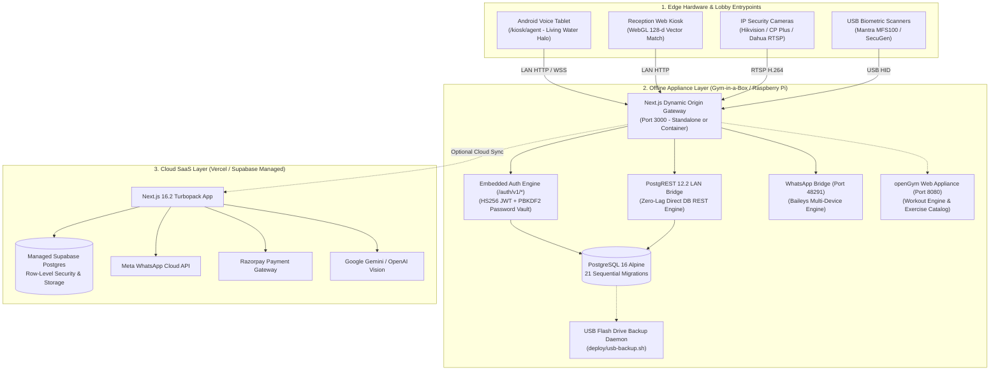

<div align="center">

  # 🏋️‍♂️ GymERP v3.0

  ### **Autonomous Multi-Tenant Gym SaaS • 3D Tactile UI • AI Voice Kiosk • CCTV Vigilance Matrix • Zero-Internet Edge Appliance**


  <p align="center">
    <a href="FEATURES.md">🔬 Feature Taxonomy</a> •
    <a href="#-quick-evaluation-credentials-for-vcs--investors">🔑 Quick Test Fills</a> •
    <a href="#-3d-perspective-tactile-ui--craft-polish">✨ 3D Tactile UI</a> •
    <a href="#-platform-matrix">⚡ Platform Matrix</a> •
    <a href="#-system-architecture">🏛️ Architecture</a> •
    <a href="#-4-synchronized-attendance-modalities">🎯 Attendance Stations</a> •
    <a href="#-zero-cost-whatsapp-automation-engine">💬 WhatsApp Engine</a> •
    <a href="#-exercise-science--personal-trainer-hub-opengym-integration">🏋️ Workout Hub</a> •
    <a href="#-cross-platform-packaging--distribution">📱 Desktop & Mobile</a> •
    <a href="#-zero-internet-appliance-gym-in-a-box">📦 Offline Appliance</a>
  </p>

</div>

---

## ⚡ 1-Click Frictionless Setup

GymERP is engineered so gym owners and technical evaluators can launch and test the platform in seconds:

```
┌────────────────────────────────────────────────────────────────────────┐
│                        FRICTIONLESS GYM SETUP                          │
│                                                                        │
│   [ 🪟 Windows Desktop ]             [ 🐧 Linux / 🍓 Raspberry Pi ]    │
│   Double-click: start-gymerp.bat     Run: ./start-gymerp.sh            │
│            │                                    │                      │
│            ▼                                    ▼                      │
│   • Auto-detects Docker / Node.js      • Resolves local Wi-Fi IP       │
│   • Auto-provisions local config       • Auto-opens default browser    │
│            │                                    │                      │
│            └─────────────────┬──────────────────┘                      │
│                              ▼                                         │
│            [ 🌐 Browser: http://localhost:3000/setup ]                 │
│            • Step 1: Gym Profile (Name, Phone, UPI QR)                 │
│            • Step 2: Owner Login Credentials                           │
│            • Step 3: Starter Membership Plans                          │
│            • Step 4: Kiosk QR Instant Auto-Pairing                     │
│                              │                                         │
│                              ▼                                         │
│            Scan QR on screen with tablet -> Kiosk is Live!             │
└────────────────────────────────────────────────────────────────────────┘
```

### Installation Options for Owners & Evaluators

| Platform | Recommended Method | How It Works |
| :--- | :--- | :--- |
| **Windows 10 / 11** | **`start-gymerp.bat`** | Double-click batch file. Auto-starts Docker or Node, opens firewall ports 3000, 54321, 48291, and launches browser to `/setup`. |
| **Linux / Raspberry Pi** | **`./start-gymerp.sh`** | 1-line shell launcher. Resolves LAN IP (`http://192.168.x.x:3000`) and launches browser automatically. |
| **Docker Compose** | **`docker compose -f docker-compose.offline.yml up -d`** | 1-command startup for offline mini-PCs and servers. Includes DB, PostgREST, and WhatsApp bridge. |
| **Windows Desktop (.exe)**| **`desktop/` (Tauri 2.0)** | Compile native Windows installer with system tray, auto-start, and direct USB biometric drivers. |
| **Android Tablet (.apk)** | **`android-kiosk/` (Capacitor 7)**| Immersive fullscreen Android tablet APK with camera/mic permissions and persistent wake-lock. |
| **USB Auto-Backup** | **`deploy/usb-backup.sh`** | Plug any USB flash drive into the PC to automatically export a timestamped `.sql.gz` snapshot. |

---

## 🔑 Quick Evaluation Credentials for VCs & Investors

Every login portal features 1-click **Quick Fill** credentials for friction-free evaluation:

| Portal | URL Route | Role | 1-Click Test Credentials | Core Capabilities |
| :--- | :--- | :--- | :--- | :--- |
| **Gym Owner / Admin** | `/login` | `owner` | `admin@gymerp.local` / `admin123` | Gross revenue, dues recovery, biometric enrollment, staff management, settings |
| **Head Coach / Trainer** | `/staff/login` | `trainer` | `coach_raj` / `coach123` | Assigned trainee rosters, workout routines, diet charts, progressive overload tracking |
| **Front Desk Reception** | `/staff/login` | `receptionist`| `front_desk_1` / `staff123` | Real-time check-in station, member search, walk-in KYC, thermal slip printing |
| **Platform Superadmin** | `/superadmin/login` | `superadmin` | `superadmin@gymerp.com` / `superadmin123` | Tenant licensing, multi-gym revenue, platform subscriptions, global broadcasts |

> **Tip for Clean Installations**: If logging into an unseeded gym, an on-screen banner offers **Load Demo Data** to populate 5 realistic members, plans, invoices, and attendance records with one click.

---

## ✨ 3D Perspective Tactile UI & Craft Polish

GymERP combines Apple human interface design foundations with Emil Kowalski UI polish and GPU-accelerated 3D perspective depth:

1. **Hardware-Accelerated 3D Card Engine (`Card3D`)**:
   - Dynamic Euler rotation angles (`perspective(1000px) rotateX(...) rotateY(...) scale3d(...)`).
   - Dynamic specular glare reflection following cursor coordinates.
   - Damped spring reset on mouse leave for fluid physical response.
   - Applied across Attendance Stations, KPI Metrics, Barbell Calculators, and the WhatsApp Pairing Stage.

2. **Concentric Double-Bezel Radii Architecture**:
   - Outer card radius and inner container padding follow strict concentric math:
     $$\text{Radius}_{\text{inner}} = \text{Radius}_{\text{outer}} - \text{Padding}$$
   - Completely eliminates awkward corner pinching and visual crowding.

3. **Apple Spring Motion Curves**:
   - Custom cubic-bezier spring curves (`cubic-bezier(0.32, 0.72, 0, 1)`) on modals, sheets, and popovers.
   - Micro-interaction press compression (`scale-[0.98]` and `scale-[0.97]`) on all interactive buttons.


---

## ⚡ Platform Matrix

```
+-----------------------------------------------------------------------------------------------------------------------------+
|                                                 GYMERP SYSTEM CAPABILITIES                                                  |
+--------------------------+--------------------------+---------------------------+-----------------------+-------------------+
| 🏢 Multi-Tenant SaaS     | 🤖 Autonomous AI Kiosk   | 📹 Attendance Ecosystem   | 📦 Offline Appliance  | 🏋️ Exercise Science|
+--------------------------+--------------------------+---------------------------+-----------------------+-------------------+
| - Tenant & Branch RLS    | - Living Water Halo UI   | - Live RTSP Camera Matrix | - Zero-Internet Ready | - Epley/Brzycki 1RM|
| - Platform Super Admin   | - 6-Digit Pairing PIN    | - CCTV Auto-Attendance    | - Embedded Auth Engine| - Olympic Plate Math|
| - GST Tax Invoicing      | - Speech-to-Speech LLM   | - WebGL Face Match (128d) | - PostgREST LAN Proxy | - PPL & 5x5 Routines|
| - Razorpay Integration   | - KYC ID Document OCR    | - Mantra/SecuGen Scanner  | - Vector UPI QR Codes | - Overload Rules  |
| - Zero-Cost WA Bridge    | - Thermal ESC/POS Print  | - Dynamic Member QR Pass  | - 4-Step Setup Wizard | - WhatsApp Sharing|
| - Granular Role RBAC     | - Offline Auto-Pairing   | - 3D Euler Perspective    | - 1-Click USB Backup  | - openGym Sidecar |
+--------------------------+--------------------------+---------------------------+-----------------------+-------------------+
```

---

## 🏛️ System Architecture



---

## 💬 Zero-Cost WhatsApp Automation Engine

GymERP features an embedded **Baileys WebSocket Bridge** (`whatsapp-bridge/`), giving gym owners an unbeatable cost advantage over competitors using the Meta Cloud API:

- **The Problem**: Meta WhatsApp Cloud API charges Rs 0.40 to Rs 0.85 per utility and marketing conversation. For a gym with 600 members sending check-in receipts, fee reminders, and workout plans, monthly messaging costs reach **Rs 15,000 to Rs 35,000**.
- **The GymERP Solution**: Connects to the gym's standard WhatsApp smartphone via the Baileys WebSocket protocol.
- **Marginal Cost**: **Rs 0 per message**.

### Dual-Mode Pairing in 3D Stage
Inside `/dashboard/whatsapp`, gym owners can link their device using two distinct mechanisms:
1. **3D QR Prism Scan**: High-resolution dynamic QR code displayed inside a tilted 3D glass prism with laser scanning sweep animation.
2. **8-Digit Phone Pairing Code**: Allows pairing by entering an 8-digit code (`XXXX-XXXX`) into WhatsApp without camera scanning.
3. **1-Click Quick Demo Connect**: Instant live device simulation for investor demonstrations.

---

## 🎯 4 Synchronized Attendance Modalities

GymERP ensures zero member check-in bottlenecks during peak rush hours (6:00 AM -- 9:00 AM) by running four synchronized attendance channels:

| Modality | Target Device | Hardware Needed | Core Mechanism | Speed |
| :--- | :--- | :--- | :--- | :---: |
| **1. Autonomous Voice Kiosk** | Android Lobby Tablet | Tablet with front camera | Client WebGL Face Watchdog + Voice greeting + Thermal slip | `< 1.2s` |
| **2. CCTV Matrix Surveillance** | Security Cameras | RTSP IP Camera | Background RTSP stream face capture + Triage auto-logging | `< 0.8s` |
| **3. In-Browser Face Kiosk** | Reception Laptop / PC | Standard USB Webcam | 128-d vector matching in Chrome with anti-spoof liveness | `< 0.5s` |
| **4. Fingerprint & Dynamic QR** | Front-Desk Counter | Mantra / SecuGen USB reader | Biometric ISO minutiae template matching or rotating QR pass | `< 0.4s` |

### Offline Attendance Queue
If the gym's internet connection drops, attendance check-ins are signed and queued into browser **IndexedDB** (`offline-queue.ts`). The system synchronizes automatically upon reconnection with idempotent UPSERT logic, guaranteeing zero duplicate check-ins.

---

## 🏋️‍♂️ Exercise Science & Personal Trainer Hub (openGym Integration)

GymERP integrates algorithms and workout paradigms from the open-source **[openGym](https://github.com/DuarteSantos8/openGym)** project, transforming the platform into a complete fitness operating system:

```
+---------------------------------------------------------------------------------------------------------+
|                                    OPENGYM EXERCISE SCIENCE SUBSYSTEM                                   |
+--------------------------+--------------------------+---------------------------+-----------------------+
| 📐 1RM Power Formulas   | 🏋️ Olympic Barbell Math  | 📈 Progressive Overload   | 📲 WhatsApp Sharing   |
+--------------------------+--------------------------+---------------------------+-----------------------+
| - Epley: W*(1 + R/30)    | - Olympic 20kg Barbell   | - Linear Progression (LP) | - 1-Click Send Routine|
| - Brzycki: W*(36/(37-R)) | - Smith Machine (15kg)   | - Greyskull LP (AMRAP)    | - Formatted Exercises |
| - Lander & Lombardi math | - EZ-Curl Bar (10kg)     | - Double Progression      | - Target Reps & RPE   |
| - RPE / RIR adjustments  | - Greedy Plate Knapsack  | - Automated Deload (-10%) | - Trainer Notes       |
+--------------------------+--------------------------+---------------------------+-----------------------+
```

### Core Subsystems:
1. **Native Exercise Science Engine (`src/lib/workout/`)**:
   - **One-Rep Max Estimator (`one-rep-max.ts`)**: Implements Epley, Brzycki, Lander, and Lombardi formulas with RPE and RIR calibration.
   - **Barbell Plate Calculator (`plate-calculator.ts`)**: Solves exact plate pair configurations for Olympic (20kg), Smith (15kg), and EZ-curl (10kg) bars using a greedy knapsack algorithm across standard metric plates.
   - **Progressive Overload Protocols (`progression.ts`)**: Encodes Linear Progression, Greyskull LP with AMRAP final sets, Double Progression, and automatic 10% deload triggers.
2. **Personal Trainer Dashboard (`/dashboard/workouts`)**:
   - Live visual Olympic barbell plate rack with color-coded disks.
   - Interactive 1RM calculator with prescribed training zones (90%, 80%, 70%).
   - 1-Click WhatsApp workout prescription dispatch directly to clients.
3. **Member Mobile Companion (`/member/exercise`)**:
   - Workout set logger with planned sets, live weight/reps inputs, RPE exertion selectors, and rest timers.

---

## 📱 Cross-Platform Packaging & Distribution

GymERP provides dedicated native distributions across desktop, mobile, and edge environments:

### 1. Windows & Linux Native Desktop Shell (`desktop/`)
- Powered by **Tauri 2.0 (Rust)** with native system tray, auto-start, and direct USB biometric scanner drivers.
- Ultra-lightweight installer (< 15MB) with zero Chromium memory bloat.

### 2. Android Kiosk Tablet App (`android-kiosk/`)
- Powered by **Capacitor 7** with fullscreen immersive kiosk mode.
- Grants camera and microphone permissions automatically for WebRTC face recognition and voice interaction.
- Implements `WAKE_LOCK` to keep kiosk tablets awake during gym hours.

### 3. Android Manager Mobile App (`android-manager/`)
- Mobile management client for gym owners to monitor floor occupancy, collections, and dues on the go.

### 4. CI/CD Automated Build Workflows
- `.github/workflows/android-release.yml`: Assembles unsigned and release APKs on tag push.
- `.github/workflows/desktop-release.yml`: Builds native desktop installers via Tauri action.
- `.github/workflows/test.yml`: Runs the automated test suite on every pull request.

---

## 📦 Zero-Internet Appliance ("Gym-in-a-Box")

GymERP can run completely disconnected from the public internet on a local mini-PC or Raspberry Pi 4/5 installed inside the gym facility.

```
┌────────────────────────────────────────────────────────────────────────┐
│                   GYM-IN-A-BOX LOCAL APPLIANCE TOPOLOGY                │
│                                                                        │
│   [ 📱 Lobby Tablet ]       [ 💻 Reception PC ]    [ 📹 RTSP Cameras ] │
│            │                         │                       │         │
│            ▼                         ▼                       ▼         │
│   ========= Local Gym Wi-Fi / LAN Switch (No Internet Required) ======  │
│                                      │                                 │
│                                      ▼                                 │
│             +------------------------------------------------+         │
│             |  Raspberry Pi 4/5 or Intel Mini-PC Appliance   |         │
│             |                                                |         │
│             |  - Next.js Web App & PostgREST Proxy (:3000)   |         │
│             |  - Embedded Local Auth Engine (/auth/v1/*)     |         │
│             |  - PostgREST Direct API Engine (:54321)        |         │
│             |  - Standalone WhatsApp Baileys Bridge (:48291) |         │
│             |  - Local PostgreSQL 16 Database (:5432)        |         │
│             |  - Automated USB Backup Daemon (deploy/)       |         │
│             +------------------------------------------------+         │
└────────────────────────────────────────────────────────────────────────┘
```

### Launching the Local Appliance in 1 Command

```bash
# 1. Clone repository
git clone https://github.com/prashantb2400/GYM-ERP-2.git
cd GYM-ERP-2

# 2. Start the offline appliance stack
docker compose -f docker-compose.offline.yml up -d

# 3. Open browser on any device in the gym network
# Navigate to: http://<appliance-ip>:3000/setup
```

---

## 🔒 Security, RBAC & DPDP Compliance

- **DPDP Act 2023 & GDPR Compliance**: Facial descriptors are stored purely as mathematical 128-dimensional floating point vectors. Raw video footage and photographs are never stored permanently.
- **BOLA-Hardened Multi-Tenancy**: Every database query and API handler enforces tenant and branch boundaries (`gym_id` and `branch_id`).
- **Private S3 Storage & Signed URLs**: KYC identity documents and member photographs are kept in private S3 buckets accessible exclusively through short-lived signed URLs.
- **Constant-Time Verification**: Webhooks for Razorpay, WhatsApp, cron endpoints, and CCTV ingestion employ `crypto.timingSafeEqual` to prevent side-channel timing attacks.


---

## 📄 License

This project is licensed under the [MIT License](LICENSE).

<div align="center">
  <sub>GymERP -- Empowering modern gyms with autonomous AI, unified biometric intelligence, and zero-cost automation.</sub>
</div>
